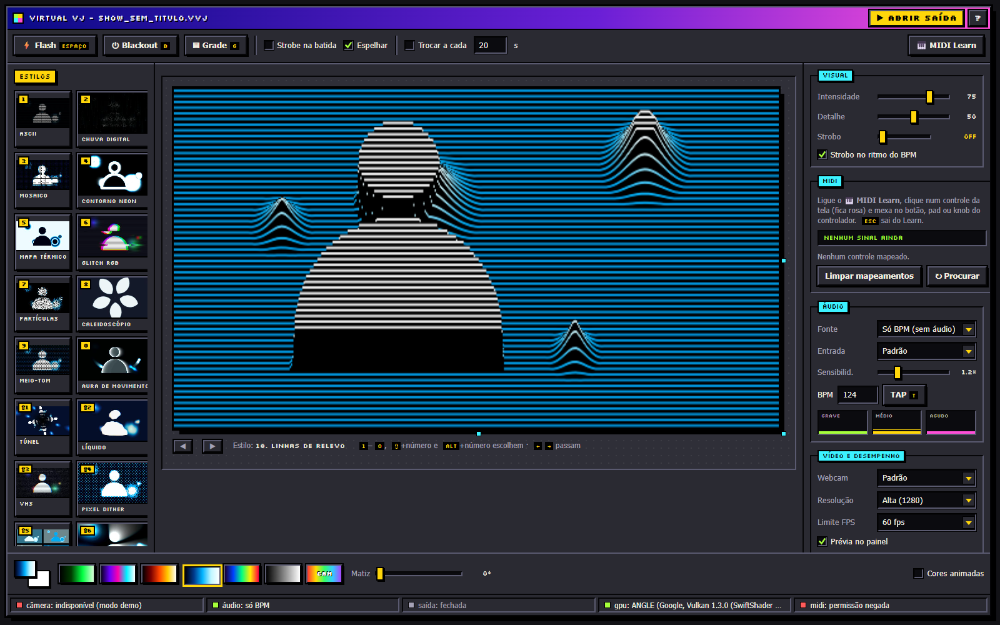
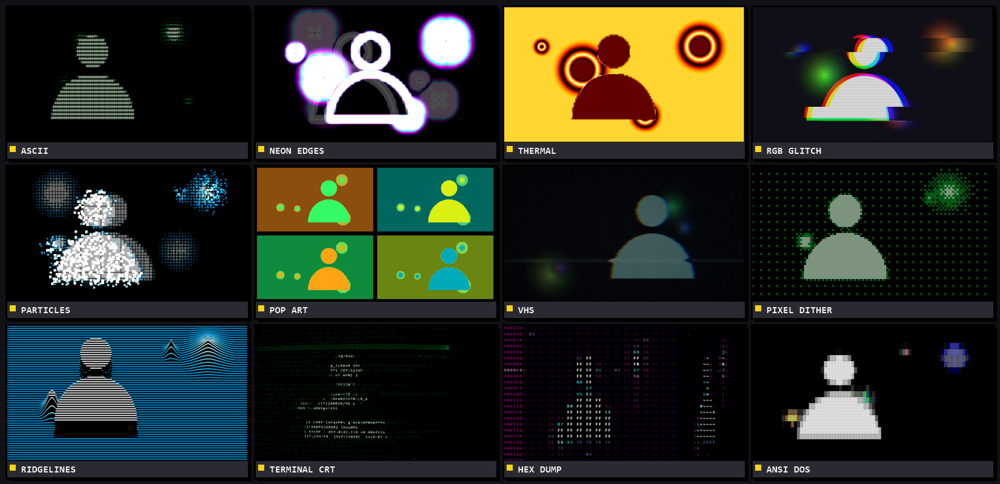

# Virtual VJ

**Virtual VJ** turns your webcam and the music into live DJ visuals on a projector — 47 GPU styles, BPM-synced strobe, MIDI Learn. No install.

 

[Live demo](https://manoelpiovesan.github.io/virtual-vj/) •
[Download](https://github.com/manoelpiovesan/virtual-vj/releases/latest) •
[Usage](#usage) •
[Guia em português](LEIA-ME.md) •
[Support](#support-the-project)

## Features

- **47 styles**: ASCII, digital rain, neon edges, neon bloom, neon chroma, glitch, tunnel, VHS, pop art, terminal, hex dump, ANSI, infinite feedback, datamosh, terrain, contour map, hex mosaic, stained glass, oscilloscope, Lissajous…
- **Your own rotation**: switch any style off (✓ on its card) to skip it in auto switch and ◀ ▶
- **Loop slots**: drag styles into 6 slots below the preview — ◀ ▶ and auto-switch cycle only those, and each slot is MIDI-mappable
- **Audio-reactive**: mic/line-in beat detection, or manual BPM with tap tempo
- **Image controls**: exposure, contrast and threshold for dim cameras or dark venues
- **Strobe knob**: off → 1 bar → 1/32, locked to the beat
- **MIDI Learn**: map any pad, knob or fader
- **Keystone**: drag 4 corners to fit a tilted projector
- **Abstract shapes source**: no webcam? Feed the effects with wireframe squares, diamonds, hexagons, stars or 3D cubes
- **Logo overlay**: drop a PNG on top of the visuals, or mix it into the camera so it gets the effect too
- **Light**: one HTML file, WebGL2 shaders, ~0.1 ms CPU per frame

## Usage

1. Extend your desktop to the projector (`Win + P`).
2. Open the [live demo](https://manoelpiovesan.github.io/virtual-vj/), or double-click `Iniciar Virtual VJ.bat` to run offline (Chrome/Edge).
3. Click **▶ Open output**, move the window to the projector and press `F` for fullscreen.

| Key | Action |
|---|---|
| `1`–`0`, `Shift`/`Alt` + number | Pick a style |
| `Space` / `B` | Flash / blackout |
| `T` | Tap tempo |
| `G` | Keystone grid |

> Screenshots use the built-in demo animation; with a webcam the visuals follow you.

## Support the Project

If you enjoy the project and want to support future development:

  

